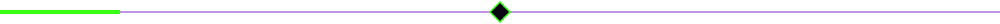

<div align="center">




<br>


&nbsp;

&nbsp;


</div>



## `> PILOT_DATA.exe`

```python
class Ileana(Pilot):
    unit        = "EVA-01"
    status      = "ONLINE"
    sync_rate   = "400%"

    campus      = "Tecnológico de Monterrey · Toluca · 4th Semester"
    major       = "Computer Technologies Engineering"

    focus = [
        "full-stack development",
        "biomedical software",
        "IoT",
        "AI pipelines",
    ]

    currently_building = (
        "Predictive Software as a Medical Device (SaMD) "
        "for BioHack CCM 2026"
    )

    tech_stack = [
        "Flutter", "React", "Next.js", "Django",
        "Laravel", "Supabase", "PostgreSQL",
    ]

    certifications = [
        "Oracle Java Programming",
        "Oracle Java Foundations",
    ]
```


## `> WEAPONS_ARSENAL.sys`

<div align="center">


</div>


## `> COMBAT_STATS.log`

<div align="center">


&nbsp;


<br><br>


<br><br>


<br><br>

<!-- Needs the snake.yml workflow (see .github/workflows/snake.yml) -->


</div>


## `> ACTIVE_OPERATIONS.db`

| Project | Tech Stack | Impact |
|-----------|------------|--------|
| 🩺 **Sistema AURORA** | Flutter · Django · LSTM · Gemini AI | Predictive Software as a Medical Device (SaMD) developed for **BioHack CCM 2026**, integrating machine learning pipelines for real-time patient monitoring. |
| 🚗 **CESVI México Platform** | React · Laravel · PostgreSQL | Designed scalable dashboards and normalized database structures for professional traffic accident reconstruction workflows. |
| 🚛 **Hagamos Composta Dashboard** | Vue 3 · Lumen · Supabase | Built an operations dashboard for logistics, route management and real-time circular economy tracking. |
| 🎵 **IngenierO Espacial Portfolio** | Next.js 15 · React 19 · Tailwind CSS | Developed a high-performance portfolio with optimized rendering, smooth animations and third-party music streaming integration. |


<div align="center">


</div>
